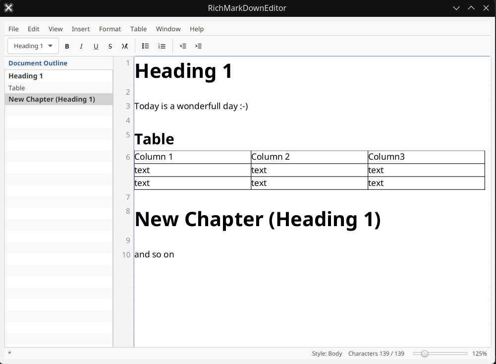
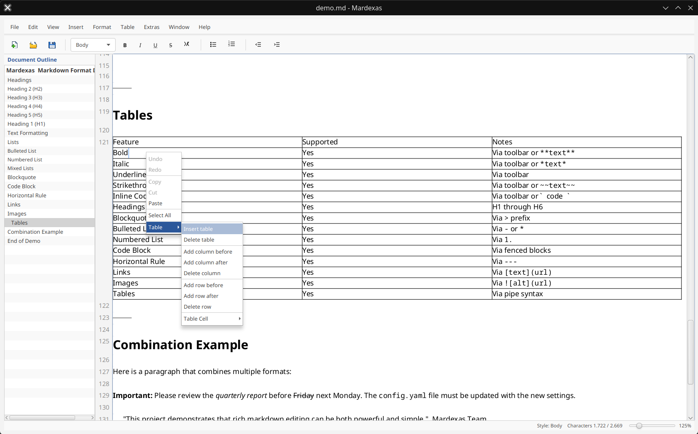

# Mardexas





**Write Markdown without having to write every formatting marker by hand.**
Mardexas is a desktop Markdown editor with a rich-text, WYSIWYG interface. Edit
your document visually, then save it as a UTF-8 Markdown file that you can open
in a text editor, review in Git, or use with other Markdown tools.

[](LICENSE)


[](https://github.com/RainerGa/Mardexas)

## Table of Contents

- [Why use Mardexas?](#why-use-mardexas)
- [Get started](#get-started)
- [Release packages](#release-packages)
- [What Markdown does it support?](#what-markdown-does-it-support)
- [Build and run from source](#build-and-run-from-source)
- [Project layout](#project-layout)
- [License and third-party software](#license-and-third-party-software)
- [Current validation status](#current-validation-status)
- [Deutsch](#deutsch)

## Why use Mardexas?

Mardexas is for people who want the portability and simplicity of Markdown but
prefer a visual editing workflow. You can concentrate on the content and use
the toolbar and menus for common formatting instead of memorizing syntax.

- **Work with existing documents:** Open `.md`, `.markdown`, and `.txt` files;
  read and write document text as UTF-8. Markdown files are saved with `.md`
  by default.
- **Format visually:** Apply headings, emphasis, lists, quotes, code, links,
  images, horizontal rules, and tables from the editor.
- **Stay oriented:** Browse document headings in the structure panel and
  optionally show paragraph line numbers.
- **Adjust the workspace:** Change zoom, check cursor position and paragraph
  style in the status bar, and print the document.
- **Use your language:** The interface is available in:

  🇩🇪 German · 🇬🇧 English · 🇫🇷 French · 🇪🇸 Spanish · 🇧🇷 Brazilian Portuguese
  🇯🇵 Japanese · 🇨🇳 Simplified Chinese · 🇮🇹 Italian · 🇰🇷 Korean · 🇳🇱 Dutch

The application and its UI currently use the name `RichMarkDownEditor`; the
GitHub project is named **Mardexas**.

## Get started

If you are comfortable building Java projects, you can try the current source
version:

1. Install [JDK 25](https://adoptium.net/) and [Maven](https://maven.apache.org/).
2. Clone the repository and its RichTextArea submodule:

   ```sh
   git clone --recurse-submodules https://github.com/RainerGa/Mardexas.git
   cd Mardexas
   ```

3. Start the editor on Linux:

   ```sh
   ./editor/start.sh
   ```

The script builds the project before launching the editor.

## Release packages

The release workflow is configured to build packages with a bundled Java
runtime, so end users do not need to install Java:

| Platform | Release files | How to use |
| --- | --- | --- |
| Linux x86-64 | Flatpak (`.flatpak`), portable runtime `.tar.gz`, and GraalVM native `.tar.gz` | Install the Flatpak with `flatpak install --user ./Mardexas-<version>-linux-x86_64.flatpak`; run it with `flatpak run io.github.rainerga.Mardexas`. The runtime archive includes Java; the native archive contains `Mardexas`, which can be run after extraction. |
| Windows x86-64 | MSI installer and portable runtime `.zip` | Run the MSI, or extract the ZIP. The portable package starts with `Mardexas\bin\Mardexas.exe`. |
| macOS | Portable `.zip` containing `Mardexas.app` | Extract the archive and move the app to Applications if desired. The filename identifies the build architecture. |

The Linux GraalVM native executable is built on a Linux GitHub Actions runner
and smoke-tested with a virtual display before it is attached to a draft
release. It is dynamically linked and needs compatible system graphics
libraries and glibc; it is not a fully static Linux binary. A Windows GraalVM
native executable is not included yet: it needs its own Windows-specific
JavaFX reachability metadata and runtime verification. The MSI and portable
Windows runtime ZIP remain available independently.

When a version tag matching the editor Maven version (currently `v1.0.0`) is
pushed, GitHub Actions builds the platform packages, the Linux native
executable, and the source archive, then creates a **draft** GitHub Release.
Review the files and release notes, then publish the draft when it is ready.
Running the workflow manually creates downloadable Actions artifacts instead;
it does not create a release.

The source archive includes the pinned `rich-text-area` submodule source, as
required when redistributing GPL-licensed binaries. Windows MSI packages and
macOS applications are currently unsigned; Windows may display a SmartScreen
warning, and macOS may block the first launch. Code signing and macOS
notarization are not configured. The application packages include the
Mardexas and RichTextArea GPL-3.0 license texts and the third-party notice
inventory; the bundled Java runtime includes its own legal notices. GraalVM
The native executable does not bundle Java, but includes the project license
and third-party notice files.

## What Markdown does it support?

The reader and writer support a practical subset of CommonMark/GitHub Flavored
Markdown, including:

- Paragraphs, blank lines, and headings (levels 1–6).
- Bold, italic, strikethrough, and inline code.
- Links and images.
- Bulleted, numbered, and nested lists.
- Block quotes, fenced code blocks, and horizontal rules.
- GitHub-style tables.

Underlining is serialized as an HTML `<u>` element; it is an extension, not part
of the CommonMark/GFM core syntax. Mardexas is not a full CommonMark or GFM
conformance implementation. Unsupported syntax or formatting can be normalized
when a document is edited and saved. A single line break may also appear
differently in other Markdown viewers. Keep a backup or review the saved diff
when editing documents that rely on unsupported Markdown features.

---

## Build and run from source

### Requirements

- JDK 25 or newer (including `jpackage`).
- Maven 3.8 or newer.
- The source build helper currently targets Linux. Release packaging is
  configured separately for Linux x86-64, Windows x86-64, and the architecture
  of the macOS runner.

The application is a modular JavaFX project. The source tree does not include
a JDK; release packages bundle their own runtime image.

### Clone and RichTextArea submodule

The RichTextArea fork is a Git submodule pinned by the Mardexas repository to
commit `e3796be52aca7c553b1531eef04dbf138114912e` on the fork's `main` branch.
That commit declares the Maven artifact version `3.0-RG`. The exact commit is
recorded in the superproject, so builds do not float to a future `main` commit.

Clone and initialize the submodule:

```sh
git clone --recurse-submodules https://github.com/RainerGa/Mardexas.git
cd Mardexas
```

If the repository was cloned without submodules:

```sh
git submodule update --init --recursive
```

The `rich-text-area` source is not copied into this repository and is not
published as a separate Maven artifact. Maven builds its `rta` module as part
of the reactor.

### Build and test

From the repository root:

```sh
mvn test
```

Build without running tests:

```sh
mvn -DskipTests package
```

The tests include JavaFX UI tests configured for headless Monocle. A successful
compile/package does not by itself establish that all UI tests pass.

### Run

On a supported Linux system, use the helper script:

```sh
./editor/start.sh
```

Alternatively, build/install the reactor modules and start the editor:

```sh
mvn -pl editor -am install
mvn -f editor/pom.xml javafx:run
```

The helper script checks for Java and Maven, builds the reactor, then starts the
editor. It expects the Git submodule to have been initialized.

## Project layout

- `pom.xml` — Maven reactor parent.
- `editor/` — Mardexas / RichMarkDownEditor application and tests.
- `rich-text-area/` — Git submodule containing the upstream-derived fork.
- `.gitmodules` — submodule URL; the selected commit is recorded in Git's
  submodule entry.

## License and third-party software

Mardexas application source is licensed under the GNU General Public License,
version 3 (GPL-3.0). The complete license text is in [LICENSE](LICENSE). The
RichTextArea fork declares GPL version 3, and Gluon Emoji runtime components
declare GPL-3.0 in their source POMs. OpenJFX is distributed under GPL version
2 with the Classpath Exception. Test-only dependencies have their own
licenses.

See [THIRD-PARTY-NOTICES.md](THIRD-PARTY-NOTICES.md) for the versions, roles,
and license references identified from the current Maven dependency tree.
License metadata and notices are informational; the actual license texts,
copyright notices, selected artifacts, and distribution method govern. Anyone
redistributing binaries must comply with the applicable licenses, including
source-code and notice requirements. The automated release workflow provides
a corresponding source archive that includes the RichTextArea submodule.

## Current validation status

The Maven reactor builds from the pinned submodule, but the latest full test
run is not green: 451 tests ran, with five failures and no test errors. Three
failures were in `EditorWindowTest`, one in `LineNumberGutterTest`, and one in
`PrintSupportTest`. A separate focused run reproduced four failures in those
areas. Earlier output also logged `Invalid URL` exceptions while RichTextArea
laid out images. These issues are relevant to release readiness; the editor is
not yet represented as a validated release.

## Deutsch

Eine deutsche Version dieser README ist verfügbar unter
[README-de.md](README-de.md).
